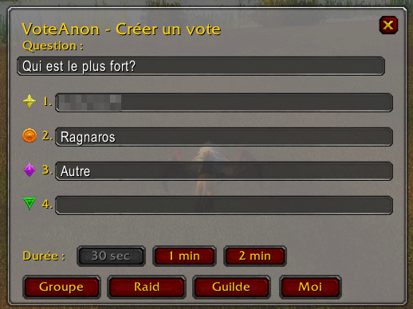
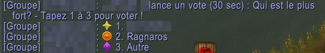
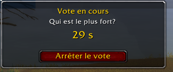
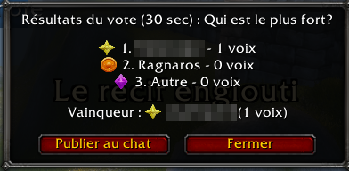
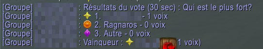

# VoteAnon

Create a 2-4 choice poll for your group, raid or guild in World of Warcraft Classic Era. Only the organizer needs the addon: everyone else votes by typing a number in chat.

## How it works

1. Type `/vote` to open the window.
2. Enter a question and 2 to 4 choices, then pick a duration: 30 seconds, 1 minute or 2 minutes.
3. Click **Group**, **Raid** or **Guild** to post the poll. **Me** lets you test the whole flow alone.
4. Players vote by typing the number of their choice in the same channel, and the organizer can vote too. If a player votes more than once, only the last vote counts.
5. A small window shows the countdown and lets you stop the poll early. At the end, a results window lets you post the results to chat.

The window is available in all 11 WoW client languages, selected automatically.

## Screenshots

*From the French client, with player names blurred.*

Creating a poll:

The poll posted in group chat:

The countdown during the vote:

The results window:

The results posted to chat:

## What "anonymous" means

Results show the total for each choice, not who voted for what. Votes are normal chat messages, so anyone in the channel can see them as they are typed.

## Installation

1. Click **Code**, then **Download ZIP**.
2. Extract the archive and rename the folder `wow-era-VoteAnon-main` to `VoteAnon`. The addon does not load under any other folder name.
3. Move the `VoteAnon` folder to `World of Warcraft\_classic_era_\Interface\AddOns\`.
4. If the game is running, quit and restart it.

## License

GNU General Public License v3.0. See [LICENSE](LICENSE).
